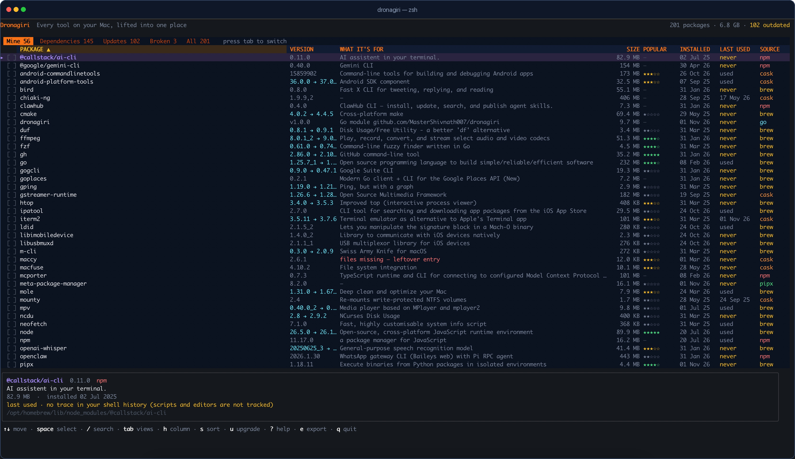

# Launch kit

Ready-to-post copy for the first backlinks. Pick one channel, post it well, and
answer every comment. Do not paste the same text into five communities on the
same day.

**Canonical project:** <https://mastershivnath007.github.io/dronagiri/>  
**Repo:** <https://github.com/MasterShivnath007/dronagiri>  
**Screenshot:** <https://raw.githubusercontent.com/MasterShivnath007/dronagiri/main/docs/screenshot.png>

## Start here, in this order

1. **dev.to article** — one durable page with a canonical link to the site.
2. **LinkedIn post** — the easiest real backlink and the one your network can
   actually see.
3. **Show HN** — high traffic, high scrutiny; only after the first two.
4. **One Reddit community** — pick the one whose rules you already know.
5. **One awesome-list PR** — after the project has a few stars, so it does not
   look abandoned.

## 1. dev.to article

Publish at <https://dev.to/new>. In the post settings, set the **canonical URL**
to `https://mastershivnath007.github.io/dronagiri/` so Google credits the site
instead of treating this as duplicate content.

**Title:** I built a CLI package manager for macOS because `brew list` hid 145 dependencies

**Tags:** `macos`, `opensource`, `go`, `showdev`

**Cover image:** `docs/og.png`

**Body:**

---

I ran `brew list` on my Mac and got 188 names.

I knew maybe 40 of them. The other 145 were libraries that arrived because
something else needed them — `abseil`, `icu4c`, `isl`, `highway`. Nothing told
me which was which, what anything did, how much space it took, or which command
would remove it safely.

That is the problem Cydia and Sileo solved on a jailbroken iPhone: one list,
searchable, with a Remove button. macOS never got that view. So I built one.

## What Dronagiri does

Dronagiri is a terminal app that reads the package databases of Homebrew, npm,
pipx, Cargo, RubyGems and `go install`, then puts everything in one sortable
table:

- real on-disk size, measured with one batched `du`
- install date
- one-line description and homepage
- last-used evidence from Spotlight and timestamped shell history
- popularity from Homebrew's public analytics
- dependencies in their own tab, each labelled with the packages that need it
- broken entries: packages a manager still lists whose files are gone



The part I use most is the **Mine / Dependencies** split. `brew list` treats the
40 tools I chose and the 145 libraries they dragged in as one flat list.
Dronagiri separates them.

## The hard parts

Two things were harder than the UI.

**Dependencies lie.** Homebrew's JSON lists declared dependencies, which is wrong
surprisingly often. Dronagiri asks `brew deps <formula>` for the actual runtime
linkage, then inverts the graph. That is why it can say "needed by ffmpeg, mpv"
instead of guessing.

**"Last used" is mostly unknowable.** APFS mounts with `noatime`, so access
times never change. Most shells do not timestamp their history. Dronagiri uses
Spotlight's `kMDItemLastUsedDate` for `.app` bundles and timestamped shell
history for commands. When neither exists, it says `never` — meaning no trace,
not proof you never ran it. The detail panel spells that out.

## Safety

Deletion is deliberately inconvenient. Select rows with `space`, press `d`, and
confirm twice in bordered dialogs. The first window lists every package and the
space freed; the second is a last-chance warning. Removal is delegated to the
manager that installed the package. No `--force`, no `--ignore-dependencies`, no
private APIs.

## Try it

```bash
go install github.com/MasterShivnath007/dronagiri@latest
dronagiri
```

Or download a binary for Apple Silicon or Intel from the releases page. It is
MIT-licensed, macOS 13+, and there is no telemetry or account.

- Website and install guide: <https://mastershivnath007.github.io/dronagiri/>
- Source: <https://github.com/MasterShivnath007/dronagiri>
- The `brew list` comparison: <https://mastershivnath007.github.io/dronagiri/#compare>

If you try it, I would like to know what your Mine/Dependencies split looks like
— and which package you were surprised to find.

---

## 2. LinkedIn post

**Post as text, attach the screenshot.**

---

I built a small tool for a problem I kept hitting on my Mac.

`brew list` showed 188 packages. About 145 were dependencies I never asked for.
I had no easy way to see which was which, how big they were, or what was safe to
remove.

Dronagiri is a terminal package manager that puts Homebrew, npm, pipx, Cargo,
RubyGems and Go packages in one list — with real sizes, install dates, last-used
evidence, and a Mine/Dependencies split. It asks twice before removing anything.

It is free, MIT-licensed, and macOS-only:
https://mastershivnath007.github.io/dronagiri/

I would genuinely value feedback from anyone who has ever stared at `brew list`
and wondered what half of it was.

---

## 3. Hacker News — Show HN

Final copy is in [content/show-hn.md](content/show-hn.md). Post at
<https://news.ycombinator.com/submit>. Use the **website**, not the repo or the
dev.to article. Do not ask for upvotes. Be present for the first two hours.

**Title:**

```
Show HN: Dronagiri – a terminal package manager for macOS
```

**URL:**

```
https://mastershivnath007.github.io/dronagiri/
```

The first comment and anticipated questions are in
[content/show-hn.md](content/show-hn.md).

## 4. Reddit

Pick **one** subreddit first. Read its rules and use the right flair. Do not
cross-post the same text to all of them.

### r/macapps

Final copy: [content/reddit-r-macapps.md](content/reddit-r-macapps.md).

**Title:** I built a free macOS package manager that puts brew, npm, pipx, Cargo, gems and Go in one list

**Body:**

---

I kept losing track of what was actually installed on my Mac. `brew list` showed
188 entries; most were dependencies. npm, pipx and Cargo each had their own
separate list.

Dronagiri is a terminal app that combines them, with real disk size, install
date, last-used evidence, and a Mine/Dependencies split. It also has tabs for
updates and broken entries, and asks twice before removing anything.

Screenshot: https://raw.githubusercontent.com/MasterShivnath007/dronagiri/main/docs/screenshot.png

Site: https://mastershivnath007.github.io/dronagiri/

It is free and MIT-licensed. I am the author, so I am biased, but I would like
to hear what breaks on your machine — especially if you use a manager I do not
cover.

---

### r/commandline

**Title:** Dronagiri – a TUI that unifies brew, npm, pipx, Cargo, gems and Go packages

**Body:** focus on the TUI and the dependency attribution, not the install pitch.
Mention Go/Bubble Tea, the batched `du`, `brew deps`, and the two-confirmation
flow. Link the repo and the website once.

### r/golang

**Title:** Built a macOS package manager in Go + Bubble Tea; dependency attribution was the hard part

**Body:** focus on the implementation: adapter interface in `internal/source`,
concurrent inventory loading, batched `du`, inverting the `brew deps` graph,
and testing a TUI with a pyte harness. Link the repo, not the marketing page.

### r/homebrew

Check the rules first; many subreddits restrict self-promotion. If allowed, use
a plain title like "A TUI for seeing which brew packages are dependencies and
how big they are", and answer questions rather than dropping a link.

## 5. X / Twitter thread

Final copy: [content/x-thread.md](content/x-thread.md).

**1/**

```
`brew list` on my Mac: 188 packages.
145 of them were dependencies I never asked for.
I built a terminal app to make that visible.
```

**2/**

```
Dronagiri reads Homebrew, npm, pipx, Cargo, RubyGems and Go.
One table: size, install date, last used, popularity, dependencies.
Mine / Dependencies is one tab away.
```

**3/**

```
The hard part was not the UI.
Homebrew's declared dependencies are often wrong.
Dronagiri asks `brew deps` for real runtime linkage, then inverts the graph.
```

**4/**

```
Removal asks twice, then delegates to the manager that installed the package.
No --force. No telemetry.
macOS 13+, MIT.
```

**5/**

```
Free download and install guide:
https://mastershivnath007.github.io/dronagiri/
```

Attach the screenshot to the first tweet.

## 6. Awesome-list PRs

Wait until the repo has a few stars and at least one external mention. Read each
list's contributing guide; entries are usually alphabetical and one line.

### `agarrharr/awesome-cli-apps`

Category: **Package Management** (or the closest existing category).

```markdown
- [Dronagiri](https://github.com/MasterShivnath007/dronagiri) - macOS package manager for Homebrew, npm, pipx, Cargo, RubyGems and Go with sizes, dates, dependencies and safe removal.
```

### `jaywcjlove/awesome-mac`

Category: **Developer Tools** or **Command Line Tools**.

```markdown
- [Dronagiri](https://mastershivnath007.github.io/dronagiri/) - A terminal package manager that unifies Homebrew, npm, pipx, Cargo, RubyGems and Go packages on macOS.
```

### `herrbischoff/awesome-macos-command-line`

Category: **Package Managers**.

```markdown
- [Dronagiri](https://github.com/MasterShivnath007/dronagiri) - Inspect, sort and safely remove packages from Homebrew, npm, pipx, Cargo, RubyGems and `go install`.
```

**PR title:**

```
Add Dronagiri package manager
```

**PR body:**

```
Dronagiri is an MIT-licensed macOS terminal package manager. It reads Homebrew,
npm, pipx, Cargo, RubyGems and go install, shows real on-disk size, install
dates, last-used evidence and dependency attribution, and delegates removal to
the package manager with two confirmations.

Site: https://mastershivnath007.github.io/dronagiri/
Source: https://github.com/MasterShivnath007/dronagiri

I am the author. Happy to adjust the entry to the list's format.
```

## 7. Product Hunt (optional)

**Tagline:** Every tool on your Mac, lifted into one place.

**Description:**

> Dronagiri is a free, open-source macOS package manager for the terminal. It
> unifies Homebrew, npm, pipx, Cargo, RubyGems and Go packages in one sortable
> table with real disk size, install dates, last-used evidence, dependencies and
> two-step safe removal.

Use `docs/og.png` as the thumbnail and the screenshot as the gallery image.

## 8. Track it

| Date | Channel | URL | Views | Stars | Sign-ups / replies |
|---|---|---|---|---|---|
| | dev.to | | | | |
| | LinkedIn | | | | |
| | Show HN | | | | |
| | Reddit | | | | |
| | awesome PR | | | | |

Check Search Console **Page indexing** after 48 hours. A new site often sits in
"Discovered – currently not indexed" for days. That is normal; keep the backlinks
coming and do not resubmit the same URL repeatedly.

## Rules

- Disclose that you are the author.
- Answer questions; do not just drop links.
- One community at a time, tailored text.
- No bought stars, reviews or backlinks.
- No fake accounts or vote rings.
- If a post is removed, read the mod message and move on; do not repost.
