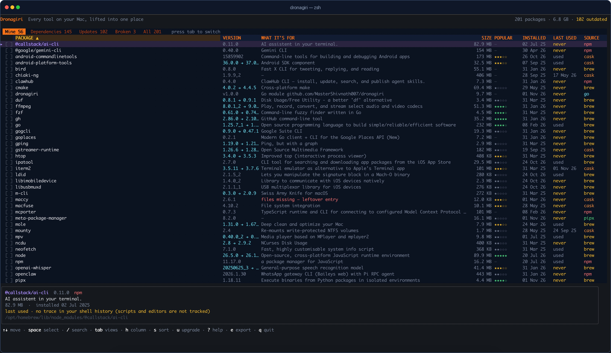

<div align="center">


# Dronagiri package manager

**Every tool on your Mac, lifted into one place.**

A free, open-source **macOS package manager** for the terminal. One list for
Homebrew formulae and casks, npm global packages, pipx tools, Cargo crates,
RubyGems and `go install` binaries — with real disk size, install dates,
last-used evidence, dependencies and safe removal.

[](https://mastershivnath007.github.io/dronagiri/)
[](https://github.com/MasterShivnath007/dronagiri/actions/workflows/ci.yml)
[](https://github.com/MasterShivnath007/dronagiri/releases/latest)
[](LICENSE)
[]()
[]()

[**Dronagiri website**](https://mastershivnath007.github.io/dronagiri/) · [**Install**](#install) · [**Keys**](#keys) · [**FAQ**](#faq) · [**Support**](#support-the-project)

<a href="https://github.com/MasterShivnath007/dronagiri/releases/latest">
  
</a>

<sub>Dronagiri 1.0.0 on macOS — 201 packages, 6.8 GB, 102 updates available. <a href="https://github.com/MasterShivnath007/dronagiri/releases/latest">Download</a> · <a href="https://mastershivnath007.github.io/dronagiri/">Website</a></sub>

</div>

## What is Dronagiri?

Dronagiri is a **macOS package manager and uninstaller for developers**. It reads
the package databases of Homebrew, npm, pipx, Cargo, RubyGems and `go install`,
then puts everything you own into one sortable table: what it does, how much
space it takes, when it arrived, when you last used it, what depends on it, and
which command removes it.

It is the idea behind Cydia and Sileo on a jailbroken iPhone — one list,
searchable, with a Remove button — applied to the Mac terminal. If you have ever
run `brew list`, seen 188 names, and had no idea which 145 were libraries you
never asked for, this is the missing view.

Dronagiri does not replace your package managers. It reads their documented
interfaces, delegates every removal and upgrade to them, and never adds
`--force`. Think of it as a **`brew list` alternative** that also understands the
rest of your machine.

The install guide, screenshots and FAQ live at
**[mastershivnath007.github.io/dronagiri](https://mastershivnath007.github.io/dronagiri/)**.

## The name

In the Ramayana, Lakshmana is wounded and needs the Sanjeevani herb. Hanuman
cannot tell which plant it is — so he lifts the entire **Dronagiri** mountain
and carries it to the battlefield.

That is the problem this tool solves. You should not have to know whether a
program came from Homebrew, npm, pipx or Cargo, or which of six commands will
remove it. Lift the whole mountain into one place and let the user pick.

## Why

macOS has no central package repository. Your tools are scattered across
Homebrew, npm, pipx, Cargo, RubyGems and `go install`, and each has its own
vocabulary for looking at them.

The usual answer, `brew list`, returns 188 entries on a normal developer Mac.
Roughly 145 of those are libraries you never asked for — `abseil`, `icu4c@79`,
`isl`, `highway`. They arrived because `ffmpeg` needed them. Nothing tells you
which is which, what anything does, or how much space it takes.

On a jailbroken iPhone, Cydia and Sileo solved exactly this: one list, grouped,
searchable, with a Remove button. `dronagiri` is that idea, for the Mac terminal.

## Dronagiri vs. `brew list`

| Capability | `brew list` | Dronagiri |
|---|---|---|
| One list across six package managers | No | **Yes** |
| Real on-disk size and running total | No | **Yes** |
| Install date and last-used evidence | No | **Yes** |
| Separates your tools from dependencies | Manual | **Yes** |
| Names the packages that need a library | No | **Yes** |
| Finds manager entries whose files are gone | No | **Yes** |
| Multi-select removal with two confirmations | No | **Yes** |
| Per-package updates | Upgrade all | **Yes** |
| Export the current view as text | No | **Yes** |
| Works over SSH, no GUI required | Yes | **Yes** |

## What it does

| | |
|---|---|
| **Space** | Real on-disk size for every package, with a running total |
| **Your list** | `Mine` hides dependencies; `All` shows everything |
| **Context** | Install date, one-line description, homepage, install path |
| **Last used** | When you last ran it, from Spotlight and shell history |
| **Popularity** | How widely a tool is installed, from Homebrew's public analytics |
| **Sort** | Any column, either direction — find your biggest or deadest tools |
| **Dependencies** | Kept in their own tab, each labelled *"needed by ffmpeg, mpv"* |
| **Broken** | Its own tab: packages a manager still lists whose files are gone |
| **Bulk removal** | Select any number with `space`, press `d`, confirm twice |
| **Updates** | `u` upgrades what you selected, or the row under the cursor |
| **Export** | `e` writes the current view to `~/Downloads` as aligned text |

## Requirements

- **macOS 13 (Ventura) or newer**, Apple Silicon or Intel. Dronagiri is macOS-only.
- Optional: Go 1.24+ if you want the single-command install or to build it yourself.
- The package managers it reads are optional too. Homebrew, npm, pipx, Cargo,
  RubyGems and `go install` are detected independently; anything missing is
  skipped rather than treated as an error.

Dronagiri reads your system and writes only to your home folder
(`~/Library/Caches/dronagiri`, and exports to `~/Downloads`). It never needs
`sudo` to inspect anything.

## Install

### Option 1 — one command (requires Go 1.24+)

```bash
go install github.com/MasterShivnath007/dronagiri@latest
```

Go places the binary in `$(go env GOPATH)/bin`, usually `~/go/bin`. If your
shell cannot find it afterwards, add that folder once:

```bash
echo 'export PATH="$PATH:$(go env GOPATH)/bin"' >> ~/.zshrc
source ~/.zshrc
```

Then just run:

```bash
dronagiri
```

### Option 2 — download a binary (no Go, no building)

1. Open the [Releases](https://github.com/MasterShivnath007/dronagiri/releases) page.
2. Download the archive for your Mac:

   | Mac | File |
   |---|---|
   | Apple Silicon (M1–M4) | `dronagiri_<version>_darwin_arm64.tar.gz` |
   | Intel | `dronagiri_<version>_darwin_amd64.tar.gz` |

3. Unpack it somewhere on your `PATH`:

```bash
tar -xzf dronagiri_*_darwin_arm64.tar.gz
sudo mv dronagiri /usr/local/bin/
dronagiri
```

> Downloaded binaries are not notarized by Apple. If macOS blocks the first run,
> clear the quarantine flag once:
>
> ```bash
> xattr -d com.apple.quarantine /usr/local/bin/dronagiri
> ```

### Option 3 — build from source

```bash
git clone https://github.com/MasterShivnath007/dronagiri.git
cd dronagiri
make install          # builds and installs to ~/.local/bin/dronagiri
```

Or without `make`:

```bash
go build -o dronagiri . && sudo mv dronagiri /usr/local/bin/
```

### Check it worked

```bash
dronagiri --version    # dronagiri 1.0.0
dronagiri              # opens the browser
```

### Uninstall

```bash
sudo rm /usr/local/bin/dronagiri     # or: rm ~/.local/bin/dronagiri
rm -rf ~/Library/Caches/dronagiri    # cached popularity data
```

Dronagiri never installs anything into your system; removing the binary is the
whole uninstall.

## Usage

```bash
dronagiri                 # interactive browser
dronagiri list            # only what you installed
dronagiri list --all      # include dependencies
dronagiri list --deps     # dependencies only, with their dependents
dronagiri list --broken   # manager entries whose files are gone
dronagiri list --json     # machine-readable
```

### Keys

| Key | Action |
|---|---|
| `↑` `↓` / `j` `k` | Move |
| `space` | Select / deselect |
| `a` | Select everything in the current view |
| `d` | Uninstall selected packages — asks twice |
| `u` | Upgrade the selected packages, or the highlighted one |
| `/` | Search name and description |
| `tab` | Switch Mine / Dependencies / Updates / Broken / All |
| `h` | Move the header highlight right |
| `H` | Move the header highlight left |
| `s` | Sort by the highlighted column; press again to reverse |
| `e` | Export the current view to `~/Downloads` as a `.txt` file |
| `r` | Reload from the package managers |
| `?` | Help |
| `q` | Quit |

## Supported managers

| Manager | List | Size | Date | Dependencies | Remove | Update |
|---|---|---|---|---|---|---|
| Homebrew formulae | ✅ | ✅ | ✅ | ✅ runtime | ✅ | ✅ |
| Homebrew casks | ✅ | ✅ | ✅ | — | ✅ | ✅ |
| npm (global) | ✅ | ✅ | ~ | ✅ | ✅ | ✅ |
| pipx | ✅ | ✅ | ~ | — | ✅ | ✅ |
| RubyGems | ✅ | ✅ | ~ | ✅ | ✅ | ✅ |
| Cargo | ✅ | ✅ | ~ | — | ✅ | ✅ |
| `go install` | ✅ | ✅ | ✅ | — | ✅ | ✗ |

`~` means the date comes from the filesystem (install directory mtime), not
from the manager's own database. It is close, not exact.

Ruby gems that ship with macOS are hidden on purpose: they belong to the
operating system, not to you.

## How it works

- **Inventory** — each manager is read through its own documented interface.
  Homebrew uses `brew info --json=v2 --installed`; npm uses `npm ls -g --json`;
  and so on. No private APIs, no scraping.
- **Real dependencies** — Homebrew's JSON lists *declared* dependencies, which
  is wrong surprisingly often. `dronagiri` asks `brew deps <formula>` for the
  actual runtime linkage, then inverts the graph so every library can name the
  packages that need it.
- **Sizes** — a single batched `du` call over all install paths. For casks it
  takes the largest of the app bundle, binary targets and the Caskroom copy.
- **Broken detection** — every recorded install path is checked on disk.
- **Last used** — explained separately below, because it is the one number that
  has to be honest about its limits.
- **Removal** — always delegated to the manager that installed the package
  (`brew uninstall`, `npm uninstall -g`, …). `dronagiri` never deletes files
  itself, apart from Go binaries, which have no package database.

## How "last used" works

This one is harder than it looks, and it is worth knowing why.

- macOS mounts APFS with **noatime**, so a program's access time never changes.
  The filesystem cannot tell you when you last ran something.
- Most shells do not record timestamps in their history either.

So `dronagiri` uses two honest signals and says so:

| Signal | Applies to | What you see |
|---|---|---|
| Spotlight `kMDItemLastUsedDate` | `.app` bundles | A real date |
| Shell history with timestamps | commands | A real date |
| Shell history without timestamps | commands | `used` |
| Nothing found | everything | `never` |

`never` means **no trace in your shell history** — not proof of disuse. Tools
launched by scripts, editors, cron or GUI wrappers never appear there, which is
why the detail panel spells that out too. To get real dates for commands,
enable timestamped history:

```bash
# ~/.zshrc
setopt EXTENDED_HISTORY
```

## How popularity works

`★` ratings come from Homebrew's public analytics: the number of installs in
the last year across all Homebrew users.

| Installs / year | Rating |
|---|---|
| 2,000,000+ | ★★★★★ |
| 500,000+ | ★★★★☆ |
| 100,000+ | ★★★☆☆ |
| 10,000+ | ★★☆☆☆ |
| any | ★☆☆☆☆ |
| no data | — |

The datasets are about 6 MB, so they are downloaded **in the background** —
the package list never waits for them — and cached for 14 days in
`~/Library/Caches/dronagiri/`. The first run shows `—` until the download
finishes. Only Homebrew publishes such numbers, so npm, pipx, Cargo and gem
packages stay at `—` rather than being given a made-up score.

Popularity says nothing about whether *you* need a package. A niche tool you
use daily is still worth keeping.

**This works for everyone who installs the tool** — the ratings come from a
public dataset, not from anything specific to one machine. The download is the
same file for every user, so nothing about your installed packages is sent
anywhere.

## Safety

- Nothing is removed until you press `d` **and** confirm **twice** in a
  bordered dialogue.
- The first window lists every package and the space freed. The second is a
  last-chance warning that cannot be undone.
- `d to remove` in the footer is red whenever a selection is active.
- Packages that are dependencies are called out before removal.
- Packages owned by macOS are marked protected and skipped.
- Removal commands are the manager's own; `dronagiri` adds no `--force`.

## Roadmap

- [x] GitHub Pages site and search-friendly documentation
- [ ] Signed and notarized binaries, so Gatekeeper does not ask
- [ ] `--dry-run` for scripted removals
- [ ] Unused-dependency view built on `brew autoremove --dry-run`
- [ ] Disk treemap panel
- [ ] Homebrew tap for `brew install dronagiri`
- [ ] Optional snapshot/restore in the spirit of `brew bundle`

## FAQ

### Is Dronagiri free?

Yes. It is MIT-licensed open source, with no account, subscription or telemetry.
You can read every line, build it yourself, or download a release binary.

### Does it work on Apple Silicon and Intel Macs?

Yes. Releases include separate `arm64` (Apple Silicon) and `amd64` (Intel)
builds. The minimum is macOS 13 Ventura, and it runs over SSH without a GUI.

### Does Dronagiri need `sudo`?

No for scanning or listing. Removing some casks can ask for your password
because macOS owns those files. Dronagiri never deletes package files itself —
it calls the manager that installed the package.

### Is it a Homebrew GUI?

No. It is a terminal UI, closer to `htop` or `lazygit` than to Cakebrew. It also
reads npm, pipx, Cargo, RubyGems and `go install`, which most Homebrew GUIs do
not.

### Does it collect data?

No. There is no telemetry. Popularity stars come from Homebrew's public install
analytics; the datasets are downloaded in the background and cached locally for
14 days. Nothing about your installed packages is sent anywhere.

### Can I install it with Homebrew?

Not yet. Today the options are `go install`, a release binary, or building from
source. A Homebrew tap is on the roadmap.

### Why is it called Dronagiri?

In the Ramayana, Hanuman cannot tell which herb will save Lakshmana, so he lifts
the entire **Dronagiri** mountain and carries it to the battlefield. That is the
idea here: instead of hunting through six package managers, lift the whole
inventory into one place and choose from it.

## Support the project

Dronagiri is free and will stay MIT-licensed. If it saved you an afternoon:

- **Star the repo** — it helps other Mac users find it.
- **Share it** — a post, a tweet or a mention in your team chat.
- **[Sponsor on GitHub](https://github.com/sponsors/MasterShivnath007)** — recurring support for maintenance.
- **[Request a paid environment audit](https://github.com/MasterShivnath007/dronagiri/issues/new?title=Mac%20cleanup%20request&body=What%20would%20you%20like%20cleaned%20up%3F%0A%0AMac%20model%3A%0AmacOS%20version%3A%0AApprox.%20free%20space%3A)** — a 60-minute remote session using Dronagiri to find dead weight, broken entries and safe removals on your Mac. $49, including a prioritised cleanup report and seven days of follow-up questions.

There is no paywalled feature in the current release, and there will not be one
hidden inside the MIT code. Read the full [support policy](SUPPORT.md) for
sponsorship tiers, paid audits and custom work.

## Contributing

Issues and pull requests are welcome. Please run `make check` before opening a
PR — it formats, vets and tests.

Adding a manager means implementing one small interface in `internal/source`.
See `npm.go` for the shortest example.

## License

MIT — see [LICENSE](LICENSE).
