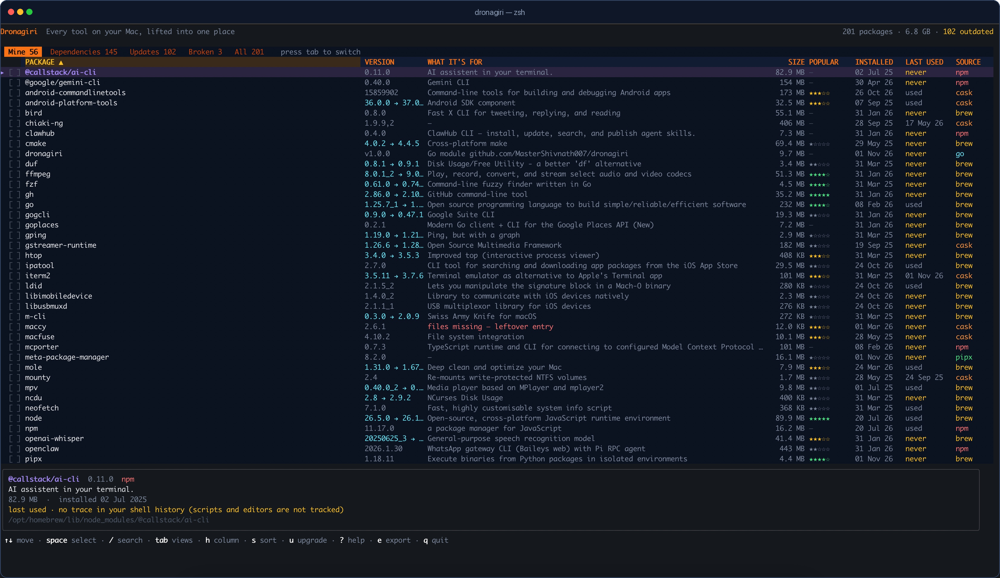

<!--
DEV.TO PUBLISHING SETTINGS

Title:
I built a Cydia-style package manager for macOS because brew list hid 145 dependencies

Tags:
macos, opensource, go, showdev

Canonical URL:
https://mastershivnath007.github.io/dronagiri/

Cover image:
Upload docs/og.png from the repository.

Do not paste this comment into the post.
-->

I ran `brew list` on my Mac and got 188 names.

I knew maybe 40 of them. The other 145 were libraries that arrived because
something else needed them — `abseil`, `icu4c`, `isl`, `highway`. Nothing told
me which was which, what anything did, how much space it took, or which command
would remove it safely.

That is the problem Cydia and Sileo solved on a jailbroken iPhone: one list,
searchable, with a Remove button. macOS never got that view. So I built one.

## What Dronagiri does

Dronagiri is a terminal app that reads the package databases of Homebrew, npm,
pipx, Cargo, RubyGems and `go install`, then puts everything in one sortable
table:

- real on-disk size, measured with one batched `du`
- install date
- one-line description and homepage
- last-used evidence from Spotlight and timestamped shell history
- popularity from Homebrew's public analytics
- dependencies in their own tab, each labelled with the packages that need it
- broken entries: packages a manager still lists whose files are gone



The part I use most is the **Mine / Dependencies** split. `brew list` treats the
40 tools I chose and the 145 libraries they dragged in as one flat list.
Dronagiri separates them.

## The hard parts

Two things were harder than the UI.

**Dependencies lie.** Homebrew's JSON lists declared dependencies, which is wrong
surprisingly often. Dronagiri asks `brew deps <formula>` for the actual runtime
linkage, then inverts the graph. That is why it can say "needed by ffmpeg, mpv"
instead of guessing.

**"Last used" is mostly unknowable.** APFS mounts with `noatime`, so access
times never change. Most shells do not timestamp their history. Dronagiri uses
Spotlight's `kMDItemLastUsedDate` for `.app` bundles and timestamped shell
history for commands. When neither exists, it says `never` — meaning no trace,
not proof you never ran it. The detail panel spells that out.

## Safety

Deletion is deliberately inconvenient. Select rows with `space`, press `d`, and
confirm twice in bordered dialogs. The first window lists every package and the
space freed; the second is a last-chance warning. Removal is delegated to the
manager that installed the package. No `--force`, no `--ignore-dependencies`, no
private APIs.

## Try it

```bash
go install github.com/MasterShivnath007/dronagiri@latest
dronagiri
```

Or download a binary for Apple Silicon or Intel from the releases page. It is
MIT-licensed, macOS 13+, and there is no telemetry or account.

- Website and install guide: <https://mastershivnath007.github.io/dronagiri/>
- Source: <https://github.com/MasterShivnath007/dronagiri>
- The `brew list` comparison: <https://mastershivnath007.github.io/dronagiri/#compare>

If you try it, I would like to know what your Mine/Dependencies split looks
like — and which package you were surprised to find.
